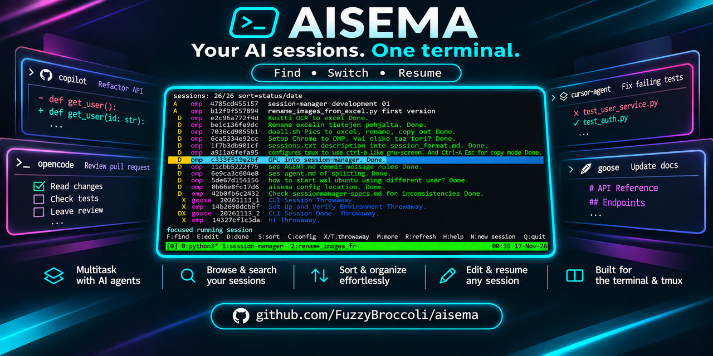

# Aisema


A small curses TUI for browsing, searching, sorting, editing, and resuming coding-agent sessions.

`Aisema` keeps a human-readable session log, optionally discovers recent sessions from installed agent harnesses, and launches or focuses the selected session. It is designed for terminal and tmux workflows.

## Features

- Browse and search a human-editable `sessions.txt` file.
- Resume supported sessions with `Enter`.
- Focus already-running sessions instead of launching duplicates.
- Create a temporary new session with `N` or `:new session`.
- Discover recent sessions from installed harnesses:
  - `copilot`
  - `cursor-agent`
  - `opencode`
  - `omp`
  - `goose`
  - `codex`
- Extend discovery, command parsing, and activity detection with drop-in runner plugins.
- Detect active OMP terminal sessions through terminal-session metadata.
- Show ordered OMP recaps and user queries in the `M` popup.
- Sort with independent primary and secondary sort layers.
- Mark sessions done or throwaway without deleting history.
- Show full commands, short runner/ID commands, or hide the command column.
- Preserve blank lines, ordering, descriptions, and final-newline state when saving.
- Use atomic session-file writes.

## Requirements

- Python 3.10 or newer.
- A Unix-like terminal with curses support.
- Optional: tmux for detached launches and pane/window focusing.
- Optional: supported agent harness executables for discovery and new-session creation.

The project uses Python’s standard library and has no repository dependency file or package installer configuration.

## Run from a checkout

```sh
./aisema
```

The default configuration path is:

- Configuration: `~/.config/aisema/config`

Use explicit paths when running from another directory:

```sh
./aisema \
  --file /path/to/sessions.txt \
  --config ~/.config/aisema/config
```

The session file is created if it does not exist. Its path can be changed with `sessions_file` in the configuration or overridden with `--file`. The configuration file is created with commented defaults on first run.

## Discover recent sessions

Without a positional selector, startup loads the configured session file and adds currently active discovered sessions. Pass a positive count to discover that many newest sessions across installed supported harnesses, or use `all` to discover every available session:

```sh
./aisema 20
./aisema all
```

Discovery entries are temporary until changed. Editing their description or changing a marker materializes them into `sessions.txt`.

Codex is discovered when the `codex` executable is installed. Aisema reads
`$CODEX_HOME/sessions/YYYY/MM/DD/rollout-*.jsonl` (default:
`~/.codex/sessions/...`) and uses the rollout’s UUID thread ID. `.jsonl.zst`
rollouts are identified from their filename and mtime only because Aisema
does not include a zstd decoder. Codex uses the generic active-process and
new-session flows.

## Runner plugins

Built-ins and external runners share the public API in
[`session_manager/runner_api.py`](session_manager/runner_api.py). To integrate
another harness, adapt the working
[`examples/runner_template.py`](examples/runner_template.py) using verified CLI,
storage, and process facts, then install the module directly in
`~/.config/aisema/runners/` and restart Aisema. No core registration, parser,
process, or TUI edits are required. See [`add_runner.md`](add_runner.md) for the
versioned contract, command-boundary rules, and onboarding checklist.

The plugin directory is fixed even when `--config` points elsewhere. Aisema loads
direct `.py` children except names beginning with `_`; it does not hot-reload or
install dependencies. Invalid plugins fail startup with their path and reason.
**Plugins execute trusted Python with your user's privileges and are not
sandboxed.** Review them before installation. The template's `example` CLI and
JSON format are illustrative; no actual HARRI integration is claimed.

Executable availability gates automatic discovery and the new-session picker,
not saved-command parsing or explicitly selected discovery. A missing plugin
leaves its custom-syntax saved lines visible but unlaunchable. Canonical runner
identities may differ from owned executable basenames.

## Session file format

Each non-empty line contains a complete resume command, one or more spaces, and a free-form description:

```text
omp --resume 01a0f35d-3bdf-729e-85df-e2c96a772f4d Investigate the import failure
codex resume 019e029c-b1e9-7e31-992e-df4638cf8ee8 Investigate the import failure
```

Built-in command shapes include:

```text
<runner> [--flags] --resume <id> [--flags] <description>
<runner> [--flags] --resume=<id> [--flags] <description>
<runner> [--flags] --session <id> [--flags] <description>
<runner> [--flags] --session=<id> [--flags] <description>
goose [--flags] session resume --name <id> [--flags] <description>
codex resume <session-id> <description>
```

Registered plugins recognize their own command grammar and exact command boundary.
For unknown executables, the generic `--resume`/`--session` forms remain supported.
Unrecognized lines stay visible and searchable but cannot be launched. Recognized
commands and their exact separating spaces survive description/marker edits.

Descriptions ending in ` Done.` remain visible as completed history. Descriptions ending in ` Throwaway.` are hidden by default. Both markers may be combined as `Done. Throwaway.`.

See [`session_format.md`](session_format.md) for the complete format and rendering specification.

## New sessions and tmux

Press `N` or run `:new session` to choose an installed harness and create a temporary session.

The manager records the existing IDs for that harness, launches the new session, and polls harness discovery for the newly generated ID. When the ID becomes available, the in-memory command changes to the harness-specific resume command and the hash appears in the session list with the `N` marker.
Cursor has one runner identity, `cursor-agent`, owning both `cursor-agent` and `agent` executables. Either executable makes it available; the `N` picker always offers `cursor-agent`. Generated new/resume commands prefer `cursor-agent` when installed and fall back to `agent` when only that alias is installed; with neither installed they default to `cursor-agent`. Existing stored commands using either name remain exact and resume without rewriting.

New-session behavior:

- Launching alone does not write the temporary entry to `sessions.txt`.
- Editing the description saves the captured resume command and ID.
- Leaving the description untouched keeps the entry ephemeral. On first ID
  discovery, its placeholder is replaced by the harness's discovered description
  (usually prompt text); a user-edited description is never replaced.
- If discovery is delayed, description editing waits briefly for the ID and will
  not save a bare runner command. An edited description without an ID is shown in
  the error color (red by default), even when selected. Once the ID is discovered,
  the edit is saved and normal description coloring returns.
- In tmux, `A` remains visible while the tracked new-session pane exists, even
  before an ID is available. `Enter` focuses that original pane instead of opening
  another window.
- For ordinary inactive persisted entries, `Enter` launches the exact stored command in a new tmux window.

Tmux focus uses pane/window identifiers. Those identifiers are separate from the agent harness session ID; the harness ID comes from the harness’s session metadata.

Cursor activity detection first matches session IDs in argv, then checks processes owned by `cursor-agent` or `agent` for open `~/.cursor/chats/<project>/<session-id>/store.db` file descriptors (including `-wal` and `-shm` sidecars). The structural path identifies the exact session ID, not an arbitrary substring. Ownership metadata, including an empty result, is cached in `snapshot.runner_data['cursor-agent']` once per process snapshot.

## Forking sessions

Press `F` on a recognized session with an ID. Search remains available through
`:find TEXT` and `Ctrl-W`.

The first popup offers, in order:

1. **Native fork**, when supported by the installed runner. Cursor and Copilot
   open the source in a new terminal and explicitly ask you to enter `/fork`;
   Aisema does not inject keystrokes. OMP uses this manual path when its installed
   CLI does not expose `--fork`.
2. **Transfer session to another runner**. Choose an installed destination, then
   choose **Full session** or **Compress first using the source runner**.
3. Session-written Markdown files whose filenames contain `plan`
   (case-insensitive), followed by other Markdown files mentioned in the session.
   Selecting a file opens the destination picker with the source runner selected
   by default, if installed. The file's current contents become the handoff.

Transfer reads complete stored/exported session data, including assistant and
tool records, rather than just the description or user prompts. It creates a
fresh destination conversation seeded with context, **not a native import of
message roles**. OMP, Goose, and Copilot have file-ingestion interfaces; Codex,
Cursor, and OpenCode receive an instruction to read the entire durable handoff
file. Aisema does not truncate the file to fit a command-line argument.

Compression runs a fresh non-interactive instance of the **source** runner with
the complete transcript and a handoff-summary request. It never resumes the
original session. This uses that runner's configured model/credentials and may
incur model usage. Summaries are lossy; a failed or empty summary does not start
the destination. Tool restrictions are applied where supported, but runner
plugins/startup hooks are not an OS sandbox. Some runners persist the fresh
summary session; Goose's no-session mode may create a hidden session.

Popups support arrows, Page Up/Down, Home/End, Enter, and `q`/Escape to cancel.
Cancelling before launch creates no child or handoff job. Fork children follow
the normal temporary `N`/ID-adoption/description-save lifecycle. In tmux they open
in detached windows; Enter focuses the tracked child rather than its source.

Handoffs may contain sensitive, unredacted history. They are retained under
`$XDG_DATA_HOME/aisema/forks/` (default `~/.local/share/aisema/forks/`) in private
directories so the child can read them after Aisema exits. Relative Markdown
paths use the source session's recorded working directory, never an inferred
workspace scan. Missing/unreadable files produce an error when selected.

### Native fork mechanisms researched

Installed help selects the usable CLI mechanism; unsupported older versions are
not assumed to accept current flags.

| Runner | Native mechanism |
|---|---|
| Codex | [`codex fork ID`](https://developers.openai.com/codex/cli/reference#codex-fork) |
| OMP | [`omp --fork ID`, or interactive `/fork`](https://github.com/can1357/oh-my-pi/blob/main/docs/session-operations-export-share-fork-resume.md) |
| Cursor | [Interactive `/fork`](https://cursor.com/docs/cli/reference/slash-commands); no documented external fork-by-ID flag |
| Copilot | [Interactive `/fork`](https://docs.github.com/en/copilot/reference/copilot-cli-reference/cli-command-reference); no documented external fork-by-ID flag |
| OpenCode | [V1 `--session ID --fork`](https://opencode.ai/v1/docs/cli/); [V2 `mini --session ID --fork`](https://github.com/anomalyco/opencode/blob/dev/packages/cli/src/commands/commands.ts) |
| Goose | [`goose session --resume --fork --session-id ID`](https://github.com/aaif-goose/goose/blob/main/documentation/docs/guides/goose-cli-commands.md) |

Goose JSON and OpenCode JSON exports are used for database-backed sessions.
OpenCode exports settled conversation messages, not unfinished running events.
Compressed Codex journals require the `zstd` executable.

## Keyboard controls

| Key | Action |
|---|---|
| `Up` / `Down` | Move selection. |
| `Page Up` / `Page Down` | Move one screen. |
| `Home` / `End` | Jump to the first or last row. |
| `F` | Fork the selected session: native, full/compressed transfer, or a referenced Markdown file. |
| `Ctrl-W` | Prompt for `:find`. |
| `E` | Edit the selected description. |
| `D` | Toggle the done marker. |
| `S` | Choose a sort mode; press `S` in the popup to switch sort layers. |
| `C` | Open the configuration editor. |
| `X` / `T` | Toggle the throwaway marker. |
| `M` | Show the full description and browse ordered recaps and user queries. The opening page includes the latest recap when available. Up/Down move one item; Page Up/Down skip five items; `M` moves down one item and closes at the last item. Home/End jump to the first/last item; `q` or Escape also closes the popup. |
| `R` | Refresh discovery by requesting five sessions beyond the amount currently loaded in the session list. |
| `H` | Show help. |
| `Enter` | Launch or focus the selected session. |
| `Q` | Quit. |
| `Escape` | Clear search or close a modal context. |

In the `E` description editor, lowercase `dd` cuts the whole line only when
these are the first two input keys after opening the editor. Idle waits do not
count as input. Any other first key consumes this shortcut; later `dd` is
ordinary text, including after a cut. `Ctrl-K` cuts the whole line at any time,
and `Ctrl-U` pastes the most recent cut from the current edit.

## Colon commands

```text
:find TEXT       Search descriptions, IDs, and commands.
:edit            Edit the selected description.
:done            Toggle the done marker.
:undone          Remove the done marker.
:sort MODE       Sort by a mode, optionally followed by desc.
:new session     Choose a harness and start a temporary session.
:date            Toggle last-used date display.
:date on         Enable last-used dates for this TUI session.
:date off        Disable last-used dates for this TUI session.
:config          Open the configuration editor.
:help            Show help.
```

Sort modes include `status`, `date`, `none`, `original`, `id`, `command`, `description`, and `active`, subject to the selected sort layer.

## Configuration

Configuration is stored at `~/.config/aisema/config` by default. Supported settings include:

```ini
display_command=full
show_throwaway=false
show_done=true
date_format=%d.%m.%Y
show_last_used_date=false
session_list_update_interval=2
color_letters=yellow
color_runner=pink
color_runner_sessionid=light_gray
color_runner_parameters=blue
color_description=white
color_description_done=green
color_description_throwaway=blue
color_selected=cyan
color_statusline=bright_cyan
color_error=red
```

`display_command` accepts:

- `full`: display the complete resume command.
- `short`: display the runner and final hyphen-separated session-ID component.
- `none`: hide the command column.

Set `show_done=false` to remove entries whose description ends with ` Done.` from the session list. The default is `true`. `session_list_update_interval` controls active-session and pending-session list updates in seconds; it accepts values from `0.001` through `600` and defaults to `2`.

Use `C` or `:config` to edit settings interactively. Changing a value also activates a commented setting. Configuration changes are written atomically and reloaded live.

## Development

Aisema is entirely vibe-coded. The implementation is intentionally open for inspection, experimentation, and modification.

You are welcome to fork the project and change it for your own needs. Pull requests are not accepted for this project. Instead, you can propose changes as prompts that describe the requested behavior clearly enough to implement and verify.

Prompt proposals are preferred because they preserve the project's development workflow and allow the behavior, edge cases, and user experience to be discussed before implementation.

Example prompt:

> In the session list M popup, add a `P` key that prints all displayed text formatted as a spiral. Keep the existing navigation behavior unchanged and make the output usable from a terminal.

Another example:

> In the config screen, add a `rainbow_splash=true/false` setting. When enabled, randomize the TUI colors on each program start. The setting must default to `false`, be included in the commented defaults, and be editable through the config screen.

Useful local checks:

Run the test suite:

```sh
python3 -m unittest discover -s tests -v
```

Run the compile check:

```sh
python3 -m compileall -q session_manager tests
```

The implementation is in [`session_manager/`](session_manager/) and tests are in
[`tests/`](tests/), including plugin integration coverage in
[`tests/test_runner_plugins.py`](tests/test_runner_plugins.py). The detailed
architecture and behavior handoff is in
[`session-manager-specs.md`](session-manager-specs.md).

## Version

Current package version: `0.1.0`.

## License

The Aisema program files in this repository are licensed under the GNU General Public License, version 3 or later. See [`LICENSE`](LICENSE).

This license applies to the `session_manager/` program and its related program files. It does not apply to user data handled by the program, including `sessions.txt`, AI-agent session records, prompts, transcripts, or session results. Those files remain governed by their owners' rights and by any applicable terms of the AI-agent tools or services that created them. Running Aisema does not automatically license, modify, or redistribute that user data under the GPL.

