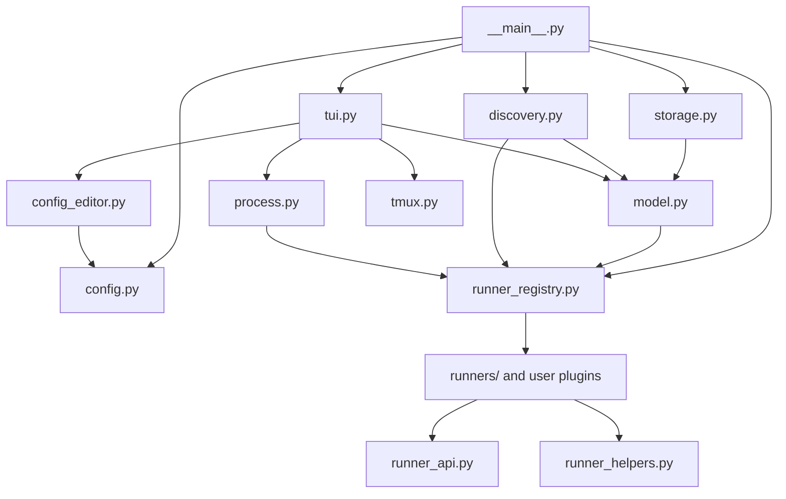

# Aisema Specifications

This document records the implemented behavior and architecture of Aisema. It is intended as a handoff document for future work. The Python source is authoritative when this document and older prose differ.

## 1. Product purpose

The application is a curses TUI for browsing, searching, editing, sorting, and resuming coding-agent sessions. It reads a human-editable session log, optionally discovers recent sessions from installed harnesses, and launches or focuses the selected session.

The implementation is a small Python package in `session_manager/`. There is no build system or external application framework. Tests live in `tests/`, including `test_session_manager.py` and the isolated plugin integration suite `test_runner_plugins.py`.

## 2. Running the application

From the repository directory:

```sh
./aisema
```

CLI options:

```text
--file PATH       Session log path. Overrides the configured sessions_file.
--config PATH     Configuration path. Default: ~/.config/aisema/config
COUNT|ALL         Optional discovery selector. Omit it to use the configured session log as the base document; the CLI still refreshes active sessions and adds active discovered entries.
```

`COUNT` must be a positive integer. `all` is case-insensitive and discovers all sessions available through installed supported harnesses. A numeric selector discovers the globally newest `COUNT` sessions across the selected installed harnesses.

The CLI parses arguments, initializes the process-local runner registry, loads configuration, chooses the session path, loads the session document, performs selector-driven discovery or active-session refresh, and starts curses through `run_tui()`. Registry loading errors become actionable argument-parser errors naming the plugin path. `--help` exits before plugin imports or configuration writes.

## 3. Repository architecture



### `session_manager/__main__.py`

- Defines CLI defaults and argument parsing.
- Initializes the same lazy runner registry used by library parsing, discovery, process matching, and the TUI.
- Loads configuration before selecting the session document path.
- Calls `load_document()`.
- Calls `available_harnesses()` and `discover_recent()` for selector-driven discovery or active-session refresh.
- Calls `run_tui()`.

### `session_manager/model.py`

Defines the session data model and parsing rules:

- `SessionEntry` represents one non-empty session line or one ephemeral discovered/temporary session.
- `parse_line()` resolves executable ownership through the registry and delegates command-boundary recognition to that runner; unregistered executables retain neutral option-form parsing. Unrecognized non-empty lines remain visible but non-launchable.
- Marker handling, session IDs, runner names, short command display, serialization, and last-used date formatting live here.

### `session_manager/storage.py`

Defines `SessionDocument`:

- Preserves parsed entries and blank lines in their original file order.
- Keeps discovered and new-session entries in an `ephemeral` list until explicitly persisted.
- Persists edits atomically through a temporary file, `fsync()`, and `os.replace()`.

### `session_manager/config.py`

Defines configuration defaults, loading, validation of selected values, and typed boolean properties. Missing settings are appended to the config file as commented defaults.

### `session_manager/config_editor.py`

Provides the in-TUI configuration editor. It understands known keys from `DEFAULTS`, preserves unrelated raw lines, keeps configuration keywords fixed, and saves atomically.

### `session_manager/discovery.py`

Provides:

- Installed-runner selection through fresh availability checks.
- Explicit runner discovery without installation gating.
- Global descending `(updated_ns, runner, session_id)` sorting and selector limits.
- `SessionEntry` construction and last-used refresh through the same registry.

### `session_manager/runner_api.py` and `runner_helpers.py`

The dependency-light public API defines `Runner`, frozen `DiscoveredSession` and
`ResumeMatch` dataclasses, neutral option-command recognition, and shared indexed
argv matching. `Runner.discover()` is abstract; availability, new/resume commands,
resume recognition, and process matching have working defaults. Concrete plugins
do not import model, discovery, process orchestration, or the TUI at module scope.

Helpers provide neutral text, prompt, timestamp, and JSON-record handling plus
`make_session()` and `generic_json_session()`. Runner-specific cleanup remains in
its runner, supplied as a callback when using generic JSON normalization.

### `session_manager/runner_registry.py`

The lazy process-local singleton `_registry` is shared by all consumers.
`RunnerRegistry` exposes `get(name)`, `all()`, and first-token-basename ownership
lookup through `for_command(command)`. Built-ins are enumerated from
`session_manager.runners` rather than a central supported-name list.
`load_registry(plugin_dir=None)` also loads sorted, direct `.py` children of
`~/.config/aisema/runners/`, skipping underscore-prefixed stems. A custom
`--config` does not relocate this directory. An explicit `plugin_dir` supports
isolated embedding/tests, not a new CLI option.

Modules export exact integer `RUNNER_API_VERSION = 1` and a concrete `RUNNER`.
Canonical names and owned executable basenames must be nonempty and unique;
plugins cannot override built-ins. The first executable of the declared new
command must be owned. Runners are ordered by `(order, name)`, with external
default order 100 following built-ins at 0–6. Availability is queried afresh
without reimporting modules; absent executables do not prevent registration.

Missing/empty plugin directories leave built-ins available. Unreadable existing
directories, import errors, incompatible versions, and invalid contracts raise
`RunnerPluginError` with the offending path. Unexpected runtime callback failures
are not silently converted to empty discovery or inactivity. Plugin code is
trusted, unsandboxed Python running with the user's privileges; Aisema does not
install dependencies, alter `sys.path`, scan cwd, or hot-reload modules.

### `session_manager/runners/`

One module per built-in exports the same version/instance contract as external
plugins. Each owns its filesystem/environment rules, schema normalization,
resume syntax, and any specialized process matching. Codex owns rollout filename
validation, prompt normalization, thread deduplication, and compressed-rollout
fallback. OMP owns query/recap merging and terminal metadata. The working external
template is `examples/runner_template.py`; onboarding is in `add_runner.md`.

### `session_manager/process.py`

Finds active sessions by scanning only current-user `/proc` entries and sharing one indexed `ProcessSnapshot` per refresh round. It delegates registered commands to the owning runner's `find_process()` hook and unknown commands to shared argv matching. Snapshots retain lazy TTY caching and `runner_data: dict[str, object]` for plugin metadata. OMP caches terminal markers and Cursor caches open session-store file-descriptor ownership, including empty results, once per snapshot. Plugins reuse the snapshot rather than scanning `/proc` per entry. Codex uses generic argv matching.

### `session_manager/tmux.py`

Detects tmux, enumerates panes, maps a process to a pane through the process-parent tree, focuses an existing pane, and launches a new detached tmux window. New-window launches retain the created pane/window identity so a temporary new session can be focused again without launching a duplicate window.

### `session_manager/tui.py`

Owns the curses application:

- Main list rendering and layout.
- Search, edit, marker toggles, sorting, configuration, help, and new-session flows.
- Active-state refresh.
- Launch/focus behavior.
- Live last-used timestamp refresh and formatting.

## 4. Session file format

The session file is selected by the `sessions_file` configuration key, and `--file` takes precedence over the configuration.

### 4.1 Lines

- Blank lines have no session meaning and are preserved on save.
- Each non-empty line is user-owned text.
- Recognized entries begin with a complete resume command followed by one or more spaces and a description.
- The exact command and separator survive description and marker edits; stored commands are never regenerated for launching.
- Unrecognized non-empty lines remain visible and searchable, but `parsed=False` prevents editing marker state and launching.

Recognized command patterns:

```text
<runner> [--flag ...] --resume <session-id> [--flag ...]
<runner> [--flag ...] --resume=<session-id> [--flag ...]
<runner> [--flag ...] --session <session-id> [--flag ...]
<runner> [--flag ...] --session=<session-id> [--flag ...]
goose [--flag ...] session resume --name <session-id> [--flag ...]
codex resume <session-id>
```

These are built-in examples, not a closed grammar. A registered runner's
`match_resume()` owns its syntax and must return a nonempty exact command prefix
and ID. Stored lines require literal separating spaces after that prefix.
Unregistered executables retain the generic `--resume`/`--session` grammar;
registered rejections never fall back to it. Removing a custom-syntax plugin
leaves its saved lines visible, unparsed, and launch-blocked.

### 4.2 Entry fields

`SessionEntry` fields:

| Field | Meaning |
|---|---|
| `raw` | Original serialized line. Used while the entry is clean. |
| `command` | Parsed or preserved launch command. |
| `separator` | Spaces between command and description. |
| `description` | User-visible description, including marker suffixes. |
| `line_number` | Original/pseudo line position used for original ordering. |
| `parsed` | Whether the command matched a supported resume shape. |
| `source` | `file`, `discovered`, or `temporary`. |
| `active` | Whether a matching running process was found. |
| `last_used_ns` | Last update time as Unix nanoseconds; `0` means unknown. |
| `user_queries` | Ordered user prompts extracted from discovered session metadata for the `M` popup. |
| `inspection_items` | Timestamp-ordered `(timestamp, kind, text)` recap/query items for the `M` popup. |
| `_dirty` | Internal flag indicating that serialization must be rebuilt. |

Computed properties:

- `session_id`: ID from the owning runner's parser, or neutral option recognition for unknown commands. Generic `--name` extraction remains available for manually constructed/unparsed commands without making them launchable.
- `runner`: registered canonical identity, or the first executable basename for unknown commands. Identity and ID are computed from the current command, including after temporary ID adoption.
- `short_session_id`: final hyphen-separated component of the session ID.
- `short_command`: runner plus short ID, or the full command if no ID exists.
- `done`: description ends with ` Done.`, ignoring a trailing ` Throwaway.` marker for the done check.
- `throwaway`: description ends with ` Throwaway.`.
- `discovered`: `source == "discovered"`.
- `temporary`: `source == "temporary"`.

### 4.3 Markers

Markers are literal description suffixes:

```text
 Done.
 Throwaway.
```

- Done entries remain visible after unfinished entries and are never deleted.
- Throwaway entries are hidden by default.
- Both markers are supported, in this order: `... Done. Throwaway.`.
- `toggle_done()` preserves the throwaway suffix when present.
- `toggle_throwaway()` preserves the done suffix when present.
- Marker changes mark the entry dirty and are saved through the normal TUI save path.

## 5. Persistence and ephemeral entries

`SessionDocument.lines` contains persisted `SessionEntry` and `BlankLine` objects. `SessionDocument.ephemeral` contains discovered and newly created temporary entries.

`document.entries` returns persisted entries followed by ephemeral entries.

### Discovered entries

- Added by `add_discovered()`.
- Deduplicated against existing entries by `(runner, session_id)`.
- Assigned pseudo line numbers after the persisted file lines.
- Start with `source="discovered"`.
- Are not written merely because they were discovered.
- Become persisted when the user edits the description or changes a done/throwaway marker; materialization changes `source` to `file` and clears `N`.

### New-session entries

- Created by the `N` shortcut or `:new session`.
- Start with `source="temporary"`, the selected runner's exact `new_session_command()`, and description `New <runner> session`. Picker eligibility honors each installed runner's `hidden_when_available` relation. Cursor has one canonical `cursor-agent` choice even when only its `agent` executable alias is installed. Generated commands prefer installed `cursor-agent`, fall back to installed `agent`, and default to `cursor-agent` when neither is installed. Visible-entry/document-entry/remaining-installed ordering is preserved. Existing stored commands using either executable are not rewritten.
- Launch alone does not write the entry to the session file.
- The TUI records pre-launch known IDs for that runner, polls discovery after launch and during the normal refresh loop, and refreshes discovery when focusing the tracked tmux pane. It replaces the temporary command with the harness-specific resume command when the new ID appears, including `codex resume <id>`.
- A live tracked tmux pane also establishes activity before the harness has assigned an ID. Pane disappearance removes that activity evidence; normal process matching still applies.
- On first ID adoption, an untouched placeholder takes the discovered description, preserving done/throwaway markers. User-edited descriptions are retained instead.
- The captured ID remains ephemeral and visible with the `N` marker until the user edits the description.
- Editing the description materializes the entry into `sessions.txt`, preserving the captured resume command and updated timestamp. Done/throwaway changes alone do not materialize a new-session entry.
- An edited description with no ID uses `color_error`, including when selected. It stays in memory until discovery supplies an ID; a successful deferred save clears the pending-edit state and error message, and normal row coloring resumes.

### Atomic saves

`SessionDocument.save()` serializes only `lines`, not remaining ephemeral entries. It preserves blank lines and final-newline state, creates the parent directory, writes a sibling temporary file, flushes and fsyncs it, then replaces the target path atomically.

## 6. Discovery architecture

Built-in runner names and discovery order (orders 0–6):

```text
copilot, cursor-agent, opencode, omp, goose, codex
```

Automatic discovery and new-session selection use each registered runner's fresh
`is_available()` result; the default is `shutil.which(command_names[0])` without
starting a harness. Explicit runner discovery and saved-command parsing do not
require availability. External runners participate in global discovery through
the same registry and are ordered by `(order, name)`.

Cursor owns `command_names = ('cursor-agent', 'agent')` under the sole canonical
identity `cursor-agent`. Its availability check accepts either executable; parsing
saved commands preserves their original executable and command text.

### Built-in sources (owned by their runner modules)

- `copilot`: `~/.copilot/history-session-state` and `~/.copilot/sessions`, JSON files.
- `cursor-agent`: `~/.cursor/projects/*/agent-transcripts/*/*.jsonl`.
- `opencode`: first usable SQLite database at `~/.local/share/opencode/opencode.db` or `~/.config/opencode/opencode.db`; reads root sessions from `session`.
- `omp`: `$PI_CODING_AGENT_DIR/sessions`, or `~/.omp/agent/sessions`; recursively reads JSONL files and joins recaps from `history.db.session_recaps`.
- `goose`: `~/.local/share/goose/sessions` and `~/.config/goose/sessions`, including `sessions.db` and JSONL files.
- `codex`: `$CODEX_HOME/sessions/YYYY/MM/DD/rollout-*.jsonl`, or `~/.codex/sessions/...`; recursively validates canonical JSONL and JSONL.zst rollout filenames.

### Normalization

- `runner_api.DiscoveredSession` carries canonical runner identity, stable nonempty ID, description, resume command, optional source path (`None` for non-file-backed stores), Unix-nanosecond `updated_ns`, and query/inspection tuples. The generating runner must also recognize the resume command.
- Numeric timestamps are interpreted heuristically as seconds, milliseconds, microseconds, or nanoseconds based on magnitude.
- ISO timestamps are accepted, including trailing `Z`.
- Descriptions prefer the latest user prompt; title/name/description metadata is used as fallback.
- User queries and OMP recaps are retained as timestamp-ordered `(timestamp, kind, text)` inspection items.
- Empty descriptions fall back to `<runner> session` where necessary.
- Codex extracts `session_meta` IDs, validated filename UUIDs, event/response user prompts, and file-mtime update timestamps. Malformed or unknown JSONL records are ignored; `.jsonl.zst` files use filename and mtime fallback only.
- Each runner generates its own resume command. Built-in forms remain:

```text
cursor-agent --resume=<id>
opencode --session <id>
goose session resume --name <id>
codex resume <id>
<default-executable> --resume <id>
```

`discover_recent()` sorts all discovered metadata newest-first by `(updated_ns, runner, session_id)` and applies the requested global limit. `all` applies no limit.

`refresh_last_used(entries)` discovers all available harnesses, keeps the newest timestamp per `(runner, session_id)`, and writes that timestamp into matching `SessionEntry.last_used_ns`; unmatched entries receive `0`.

## 7. Sorting specification

Sorting is performed by `_sort_entries(entries, mode, descending, first_mode)` in `tui.py`. The application stores the first-layer mode separately from the second-layer mode.

The first layer groups rows before applying the second layer:

- `status` (default): active non-throwaway rows, inactive unfinished rows, inactive done rows, then throwaway rows.
- `none`: one group containing all rows.
- `date`: one group per local calendar date, newest date first; unknown dates are last.
- `command`: one group per runner (`omp`, `goose`, etc.), runner names ascending.

The second layer sorts only inside each first-layer group:

- `date` (default): raw `last_used_ns`, newest first; unknown timestamps (`0`) are last.
- `none`: preserve the current order.
- `original`: `line_number`.
- `id`: case-folded session ID.
- `command`: case-folded full command.
- `description`: case-folded description.
- `active`: the existing active boolean ordering.

The `descending` flag reverses non-date second-layer keys. Date ordering remains newest-first. The old `status` second-layer value remains accepted as a compatibility alias for `date`.

Pressing `S` opens the second-layer picker. Pressing `S` again while the picker is open switches to the first-layer options; pressing it again switches back. Enter applies the selected layer and option. `q` or Escape cancels. Direct `:sort MODE [desc|descending]` continues to select the second-layer mode without changing the first layer.

After sorting, `SessionApp.rebuild()` applies visibility filtering and search filtering. Hidden throwaway rows are removed unless their object ID is in `throwaway_visible`. Search matches case-insensitive description, command, or session ID.

## 8. TUI state and rendering

`SessionApp` initializes with:

- `first_sort_mode="status"`.
- `sort_mode="date"`.
- `sort_descending=False`.
- Empty query.
- No selected row and no scroll offset.
- `show_last_used_date` from configuration.
- Color pairs configured from color settings.

When date display is enabled at startup or after config reload, `refresh_last_used()` runs before rebuilding the list.

The main list layout is:

```text
[4 status slots][command column][optional date column] [description]
```

Status slots are fixed in this order:

```text
A D X N
```

`N` means the entry is not currently represented by a line in `sessions.txt`: the implementation sets it when `entry.source != "file"`. This includes discovered entries not yet materialized and newly created sessions with `source="temporary"`. A newly created session can have its discovered resume command and ID in memory while it still has `N`; editing its description materializes it and clears `N`. Missing states are spaces. The command column is either the full command or `short_command`. If enabled, the date column uses `SessionEntry.last_used_text(config.get("date_format"))`. The date is local time and is omitted for unknown timestamps.

The default date format is `%d.%m.%Y`, displayed as `dd.mm.yyyy`. Any Python `strftime` format string is accepted through the `date_format` setting. Invalid/unsupported timestamp conversion returns an empty display string; the configured format is otherwise passed to `datetime.strftime()`.

The TUI refreshes active process state and pending new-session discovery at the configured `session_list_update_interval` while drawing. Process matching uses one current-user process and terminal-session snapshot per refresh round. Focusing a tracked temporary tmux pane also triggers an immediate discovery refresh. Rebuilding preserves the selected object where possible and keeps the selected row in the visible scroll range.

## 9. Configuration specification

Default file: `~/.config/aisema/config`.

The loader:

- Creates the parent directory and a commented config when absent.
- Accepts `key=value` lines.
- Ignores blank lines, unknown keys, and malformed lines.
- Treats `#` and `;` entries as comments.
- Appends missing known defaults as comments.
- Merges active values over `DEFAULTS`.
Normalizes invalid `display_command`, `show_throwaway`, `show_done`, and `session_list_update_interval` values to their defaults; an empty `sessions_file` uses its default. `session_list_update_interval` accepts numeric values from `0.001` through `600` seconds.

Current defaults:

```ini
display_command=full
show_throwaway=false
show_done=true
date_format=%d.%m.%Y
show_last_used_date=false
session_list_update_interval=2
color_letters=yellow
color_runner=pink
color_runner_sessionid=light_gray
color_runner_parameters=blue
color_description=white
color_description_done=green
color_description_throwaway=blue
color_selected=cyan
color_statusline=bright_cyan
color_error=red
```

Properties:

- `display_command=short` enables short command display.
- `display_command=none` hides the command column; descriptions begin after the status slots and optional date column.
- Boolean properties recognize `1`, `true`, `yes`, and `on` as true; corresponding false forms are accepted for the loader/UI behavior.
- `show_throwaway=false` hides throwaway rows unless temporarily overridden by a local toggle.
- `show_done=false` hides rows whose description ends with ` Done.`.
- `sessions_file` selects the session log when `--file` is not supplied.
- `session_list_update_interval` controls active-session/list refreshes in seconds and accepts values from `0.001` through `600`.

The config editor lists every known default key. It supports:

- Up/Down/Page Up/Page Down/Home/End navigation.
- Space toggling for recognized boolean values.
- Pickers for `display_command` and `color_*` values.
- Text editing for other values, including `date_format`.
- `;` or `#` to activate/comment the selected setting.
- Changing a value also activates the selected setting if it was commented.
- Immediate atomic save and live reload after each change.
- When enough space exists, live examples include throwaway, active (`A`), selected, unsaved (`N`), done, and normal rows; all examples that fit are rendered, and rows are omitted when the terminal is too short.
- `q`, `Q`, or Escape to leave config mode.

## 10. Commands and keyboard controls

Shortcuts are case-insensitive unless noted:

| Key | Action |
|---|---|
| Up/Down | Move selection. |
| Page Up/Page Down | Move one screen. |
| Home/End | Jump to first/last row. |
| `F` | Prompt for `:find`. |
| `Ctrl-W` | Prompt for `:find`. |
| `E` | Edit selected description. |
| `D` | Toggle done marker. |
| `S` | Choose a first- or second-layer sort mode from a popup; press `S` in the popup to switch layers. |
| `C` | Open configuration editor. |
| `X` / `T` | Toggle throwaway marker. |
| `M` | Show full description plus ordered recaps and user queries; the opening page includes the latest recap when available, Up/Down move one item, Page Up/Page Down skip five items, `M` moves down and closes at the last item, and `q`/Escape closes the popup. |
| `R` | Refresh discovery by requesting five sessions beyond the amount currently loaded in the session list. |
| `H` | Show help. |
| Enter | Launch or focus selected session. |
| `Q` | Quit. |
| Escape | Clear search in the main view; closes help/config contexts. |

Colon commands:

```text
:find TEXT       Set case-insensitive search text; empty clears search.
:edit            Edit selected description.
:done            Toggle selected done marker.
:undone          Remove selected done marker.
:sort MODE [desc|descending]
                 MODE: status, original, id, command, description, active.
:new session     Choose an installed harness and start a temporary session.
:date            Toggle date display.
:date on         Enable date display for the current TUI session.
:date off        Disable date display for the current TUI session.
:config          Enter config editor.
:help            Show help.
```

`:date` changes live display state but does not write `show_last_used_date` to configuration. Configuration changes must be made through the config file/editor.

## 11. Launch and active-session behavior

When Enter is pressed on an unrecognized line, launch is rejected.

For recognized entries:

1. A newly created temporary entry with a tracked tmux pane refreshes pending ID discovery, then focuses that original pane. It does not launch another tmux window.
2. `process.find_process()` searches for a process containing the session ID and the matching runner basename.
3. If found and the process belongs to a tmux pane, the manager focuses that window/pane and switches the tmux client.
4. If found outside tmux, the manager reports that the session is already active and does not launch another copy.
5. If not active and currently inside tmux, `tmux.launch()` opens a detached new window named from the first space-delimited token of the session description, truncated to 16 characters. An empty description falls back to `session`. It runs the exact stored command.
6. If not active outside tmux, curses is suspended and the exact stored command is run through `/bin/sh`; curses is restored afterward.

Only an OMP session can also be active through OMP terminal-session metadata:
marker files under `$PI_CODING_AGENT_DIR/terminal-sessions` or
`~/.omp/agent/terminal-sessions` map `pts-*` files to session JSONL names, then an
OMP process on that TTY is matched. Other runners do not inherit this fallback.
Custom metadata belongs in the runner hook and is cached under
`snapshot.runner_data[self.name]`.
Cursor additionally checks open file descriptors of processes indexed under
`cursor-agent` or `agent`, deduplicated by PID, when argv does not identify the
session. Exact `~/.cursor/chats/<project>/<session-id>/store.db` paths and their
`-wal`/`-shm` sidecars establish ownership by the session-ID directory component,
not arbitrary substring matching. The ownership mapping, including an empty
result, is cached in `snapshot.runner_data['cursor-agent']` once per snapshot,
not rescanned per entry.

## 12. Tests and verification

Run the full test suite:

```sh
python3 -m unittest discover -s tests -v
```

Run compilation checks:

```sh
python3 -m compileall -q session_manager tests
```

The current test suite covers:

- Parsing and serialization-related marker behavior.
- Fixed status marker columns.
- New temporary session creation and harness ordering.
- Word navigation.
- Color aliases.
- Process and terminal-session detection.
- Blank-line/separator-preserving persistence.
- Discovered-entry materialization.
- Status grouping and newest-first last-used sorting.
- Throwaway visibility behavior.
- Configuration defaults, comments, custom date format, and editor behavior.
- Live date toggling.
- Harness availability lookup.
- Cross-harness and OMP discovery, prompt extraction, and timestamp ordering.
- OMP recap merging, ordered inspection items, M popup navigation, and five-item paging.
- Codex rollout discovery, filename fallback, compressed-rollout handling, query inspection, deduplication, parser/resume behavior, generic process matching, and temporary new-session polling.
- Session-list interval validation and current-user process snapshot reuse.
- Supported command shapes.
- CLI behavior without a discovery selector.
- Drop-in plugins, canonical identity versus executable ownership, custom command boundaries, availability-independent parsing/explicit discovery, contract errors, and isolated new-session lifecycle execution.

A terminal smoke test is recommended for changes affecting curses rendering or launch flow. Date rendering can be exercised with a temporary config containing:

```ini
show_last_used_date=true
date_format=%d.%m.%Y
```

## 13. Continuation guidance and invariants

Preserve these invariants when extending the code:

1. Do not reorder or rewrite user-owned session lines merely to display a sorted view. Sorting is in-memory only.
2. Preserve blank lines and the file’s final-newline state on save.
3. Persist discovered entries only when the user changes them; discovery itself remains ephemeral.
4. Deduplicate discovered sessions by `(runner, session_id)`.
5. Keep done and throwaway suffixes composable and preserve the suffix not being toggled.
6. Keep malformed non-empty lines visible but non-launchable.
7. Use the exact stored command for launching; do not reconstruct recognized file commands.
8. Keep throwaway rows after ordinary rows and hidden by default.
9. Keep last-used sorting based on raw `last_used_ns`, not formatted date strings. Formatting can lose time precision and can be customized by the user.
10. Keep the date secondary layer newest-first even when a primary sort mode is descending.
11. When adding a config key, add it to `DEFAULTS`; the loader and config editor derive their known-key lists from it.
12. When changing exported model or TUI behavior, update all call sites and add a consumer-visible test.
13. After source changes, run unit tests, compile checks, and a real TUI smoke scenario for rendering/interaction changes.
14. Integrate new harnesses through the runner API, not central runner-name branches. Verify real CLI/storage/process facts; the illustrative template and synthetic regression harness do not establish actual HARRI compatibility.

## 14. Known documentation/maintenance notes

- `session_format.md` is the user-facing format document and overlaps with this handoff specification.
- The implementation uses `X` for the throwaway shortcut; the user-facing format documentation matches the current TUI key handler.
- `session_manager/__init__.py` reports version `0.1.0`; there is no packaging metadata or release automation in this repository.
- Generated `__pycache__` files are not part of the source architecture and should not be edited or documented as source files.
